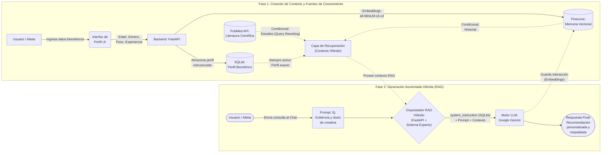

# LLM-Health-Assistant (Hybrid RAG Edition)

---

<div align="center">
  
  <p><em>Asistente de Salud y Nutrición Deportiva basado en RAG Híbrido y Google Gemini</em></p>
</div>

---

## ⚠️ Aviso Legal (Disclaimer)
Este sistema proporciona información general con fines educativos y de investigación académica, y **no constituye asesoramiento médico profesional**. No establece una relación médico-paciente ni sustituye la evaluación de un profesional de la salud o nutricionista certificado.

---

## 📑 Tabla de Contenidos
1. [📖 Introducción y Linaje del Proyecto](#-introducción-y-linaje-del-proyecto)
2. [✨ Mejoras e Innovaciones Implementadas](#-mejoras-e-innovaciones-implementadas)
3. [🏗️ Arquitectura del Sistema (RAG Híbrido)](#️-arquitectura-del-sistema-rag-híbrido)
4. [🛠️ Stack Tecnológico](#️-stack-tecnológico)
5. [📊 Validación Experimental (AGD y RMSE)](#-validación-experimental-agd-y-rmse)
6. [🚀 Instalación y Uso](#-instalación-y-uso)
7. [📜 Licencia y Atribución](#-licencia-y-atribución)

---

## 📖 Introducción y Linaje del Proyecto

**LLM-Health-Assistant (Hybrid RAG Edition)** es una plataforma de consulta de salud y nutrición deportiva impulsada por **Inteligencia Artificial Generativa** y **Generación Aumentada por Recuperación Híbrida (Hybrid RAG)**.

Este repositorio parte de una refactorización y extensión académica del proyecto de código abierto [Avalon-S/LLM-Health-Assistant](https://github.com/Avalon-S/LLM-Health-Assistant) (licencia MIT), adaptándolo para resolver uno de los principales problemas de los LLM genéricos en salud: la entrega de recomendaciones poblacionales promedio que ignoran los datos biométricos específicos del usuario y carecen de respaldo científico trazable.

---

## ✨ Mejoras e Innovaciones Implementadas

Respecto a la implementación base de Avalon-S, esta versión incorpora las siguientes mejoras arquitectónicas y funcionales:

1. **Migración del Motor LLM a Google Gemini:** Se reemplazó la dependencia de `GLM-4-Plus` (`ZHIPU_API_KEY`) por **Google Gemini (`gemini-3.5-flash-lite`)** mediante el SDK oficial `google-genai`.
2. **Capa de RAG Estructurado Determinista (SQLite siempre activo):** En lugar de depender de palabras clave frágiles para recuperar los datos del usuario desde Pinecone, el backend consulta de forma determinista el perfil biométrico en **SQLite** (`age`, `gender`, `medical_history`) en el 100% de las peticiones y lo inyecta en el `system_instruction` de Gemini.
3. **Sistema Experto Bilingüe (Español / Inglés):** Se ampliaron las reglas de activación en `backend/health_chat.py` para detectar consultas en español y términos del dominio deportivo/nutricional (*evidencia, estudio, creatina, proteína, dosis, hipertrofia*, etc.).
4. **Reescritura y Traducción de Consultas para PubMed (*Query Rewriting*):** Se mejoró `backend/query_pubmed.py` para utilizar Gemini como traductor/extractor de 2 a 4 palabras clave biomédicas en inglés antes de consultar la API de PubMed (`esearch.fcgi`), resolviendo el fallo de cero resultados ante preguntas largas en español.
5. **Extracción Completa de Metadatos y Control de Alucinaciones:** El módulo de PubMed ahora extrae **título completo, año de publicación, PMID y *abstract* íntegro** (uniendo todas las secciones XML). Además, el `system_instruction` exige citar explícitamente las fuentes recuperadas y prohíbe inventar referencias no presentes en el contexto.
6. **Evaluación Cuantitativa Reproducible:** Se incorporó un script de evaluación (`evaluacion_metricas.py`) con $N = 24$ perfiles biométricos para medir el desempeño frente a un LLM genérico usando **AGD** y **RMSE**.

---

## 🏗️ Arquitectura del Sistema (RAG Híbrido)

El sistema implementa un flujo de **RAG Híbrido de tres fuentes** orquestado por **FastAPI**:

| Fuente de Datos | Tipo de RAG | Activación | Propósito |
| :--- | :--- | :--- | :--- |
| **SQLite** | RAG Estructurado (Relacional) | **Siempre activo** (100% de consultas) | Inyectar perfil biométrico exacto en `system_instruction`. |
| **PubMed API** | RAG Científico + *Query Rewriting* | **Condicional** (palabras clave científicas/deportivas) | Recuperar artículos reales (título, año, PMID, *abstract*). |
| **Pinecone** | RAG Vectorial (`all-MiniLM-L6-v2`) | **Condicional** (referencias a historial previo) | Recuperar y almacenar memoria conversacional semántica. |



---

## 🛠️ Stack Tecnológico

### Backend y Seguridad
* **FastAPI** — Framework web asíncrono de alto rendimiento.
* **SQLite + SQLAlchemy** — Almacenamiento relacional para autenticación y perfiles biométricos estructurados.
* **Pinecone** — Base de datos vectorial para historial conversacional (índice denso de `384` dimensiones, métrica `cosine`).
* **PubMed E-Utilities API** (`esearch.fcgi` / `efetch.fcgi`) — Recuperación de literatura científica en tiempo real.
* **OAuth2.0 + JWT (`python-jose`, `passlib/bcrypt`)** — Autenticación y autorización segura por usuario.

### Modelos de IA y Embeddings
* **Google Gemini (`gemini-3.5-flash-lite`)** — Generación de respuestas personalizadas y reescritura de consultas para PubMed.
* **Sentence Transformers (`sentence-transformers/all-MiniLM-L6-v2`)** — Generación de *embeddings* locales (384 dimensiones) para búsqueda semántica en Pinecone.

### Frontend
* **HTML5, CSS3 y JavaScript (Fetch API)** — Interfaz web para inicio de sesión, gestión de perfil biométrico y chat de salud.

---

## 📊 Validación Experimental (AGD y RMSE)

Siguiendo la metodología de evaluación cuantitativa propuesta por **Pinna et al. (2025)** ($N = 24$ casos de prueba), se evaluó la precisión de dosificación del sistema frente a un LLM genérico (*Baseline* sin contexto biométrico) utilizando como *ground truth* el estándar científico de mantenimiento de creatina de la *International Society of Sports Nutrition (ISSN)*:

$$\text{Dosis de mantenimiento } (y_i) = 0.05 \times \text{peso corporal (kg)}$$

Se evaluaron **24 perfiles biométricos** con pesos entre $48\text{ kg}$ y $120\text{ kg}$ utilizando las métricas **AGD** (*Average Grade Difference*) y **RMSE** (*Root Mean Square Error*):

| Sistema Evaluado ($N = 24$) | AGD $\downarrow$ | RMSE $\downarrow$ |
| :--- | :---: | :---: |
| **Nuestro Sistema (RAG Estructurado SQLite + Gemini)** | **0.0125** | **0.0354** |
| **LLM Genérico (Baseline sin perfil biométrico)** | 1.1521 | 1.3680 |
| **Reducción de Error Relativa** | **98.9%** | **97.4%** |

> **Conclusión experimental:** Mientras el LLM genérico incurre en errores sistemáticos al recomendar dosis poblacionales fijas ($4\text{--}5\text{ g/día}$), la inyección determinista del perfil biométrico desde SQLite reduce el error promedio en un **98.9%** y elimina las desviaciones extremas en atletas de peso bajo o elevado.

---

## 🚀 Instalación y Uso

### 1. Clonar el repositorio y crear el entorno
```bash
conda create -n sde python=3.10
conda activate sde
git clone https://github.com/<TU_USUARIO>/<TU_REPOSITORIO>.git
cd LLM-Health-Assistant
pip install -r requirements.txt
```

### 2. Configurar variables de entorno
Crea un archivo `.env` en la raíz del proyecto (asegúrate de que esté listado en `.gitignore`):

```env
SECRET_KEY=tu_clave_secreta_jwt
GEMINI_API_KEY=tu_api_key_de_google_gemini
PINECONE_API_KEY=tu_api_key_de_pinecone
```

> **Configuración requerida en Pinecone:** Crea un índice llamado `healthassistant` de tipo **Dense / Custom vectors** (sin *document schema*), con **Dimension = `384`**, **Metric = `cosine`**, en **AWS (`us-east-1`)**.

### 3. Ejecutar el servidor FastAPI
```bash
uvicorn main:app --host 0.0.0.0 --port 8000 --reload
```
* **Interfaz Web:** `http://localhost:8000/`
* **Documentación interactiva de la API:** `http://localhost:8000/redoc` o `http://localhost:8000/docs`

### 4. Reproducir la evaluación de métricas (AGD y RMSE)
```bash
python evaluacion_metricas.py
```

---

## 📜 Licencia y Atribución

Este proyecto se distribuye bajo la **Licencia MIT** (ver archivo `LICENSE`), manteniendo la atribución correspondiente al repositorio original [Avalon-S/LLM-Health-Assistant](https://github.com/Avalon-S/LLM-Health-Assistant).